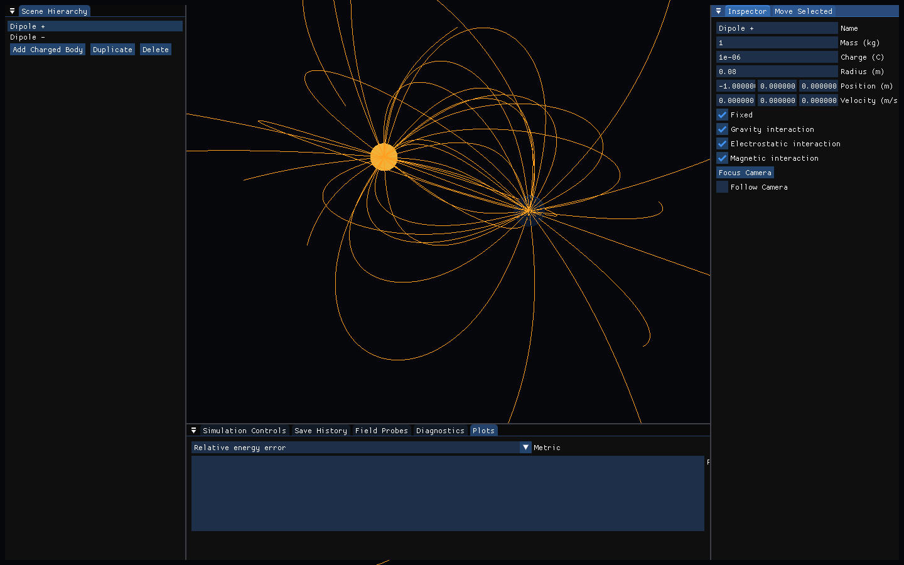
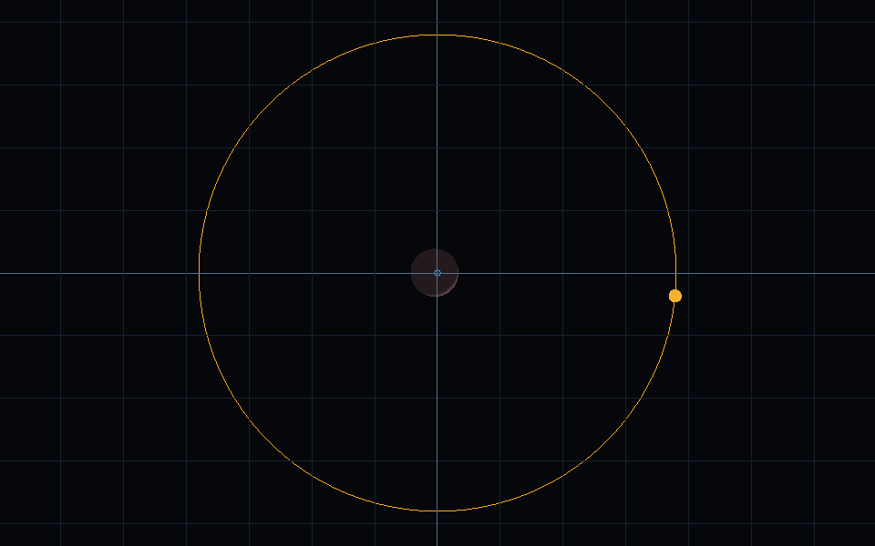
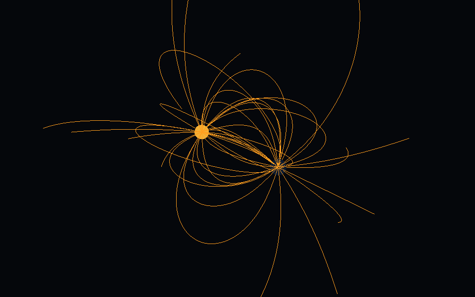
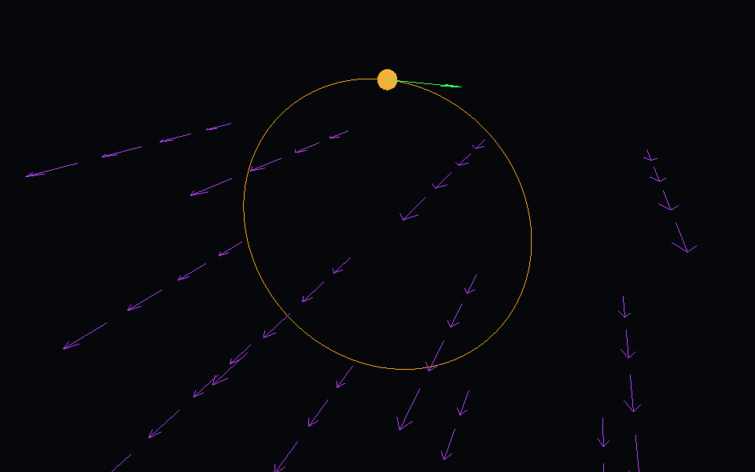
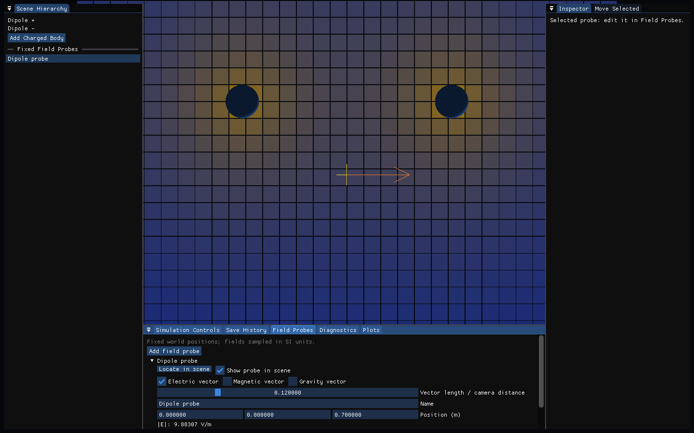

# Aetherion

Explore orbits, electric fields, and charged-particle motion in an interactive C++ physics simulator.



[Quick start](#quick-start) · [Try the demos](#try-the-demos) · [Controls](#controls) · [User guide](GUIDE.md) · [Math & techniques](TECHNICAL_GUIDE.md)

## Quick start

You need **CMake 3.25+, Ninja, C/C++20 compilers, Git, Python 3 + Jinja2**, and an
OpenGL 4.1-capable graphics driver. The first configure downloads pinned dependencies.

```sh
python -m pip install Jinja2
cmake --preset dev
cmake --build --preset dev
ctest --preset dev
```

Launch `build/dev/aetherion_app` on Linux, or `build\dev\aetherion_app.exe` on Windows.

<details>
<summary>Windows: explicit MSYS2/UCRT64 build commands</summary>

In PowerShell, from the repository root:

```powershell
$env:Path = "C:\msys64\ucrt64\bin;" + $env:Path
cmake -S . -B build/windows-gcc -G Ninja `
  -DCMAKE_C_COMPILER=C:/msys64/ucrt64/bin/gcc.exe `
  -DCMAKE_CXX_COMPILER=C:/msys64/ucrt64/bin/g++.exe
cmake --build build/windows-gcc --parallel
ctest --test-dir build/windows-gcc --output-on-failure
.\build\windows-gcc\aetherion_app.exe
```

Keep CMake and Ninja on `PATH` too. Never share a build directory between GCC, MSVC,
Windows, and WSL. See [build troubleshooting](GUIDE.md#build-troubleshooting).

</details>

## Try the demos

These are **real renderer/UI captures**, not mockups. Animations use accelerated fixed-step
playback; body sizes and field density are adjusted for readability.
[Capture settings and regeneration](media/readme/README.md).

### 1. Watch the Moon orbit Earth



In **Simulation Controls**, choose **Earth-Moon**, enable **Object trails**, then press **Play**.
Try **Time scale = 100000**, **Trail duration = 2500000 s**, and **Body radius multiplier = 6**.
Use **Follow center of mass camera** and zoom out until the orbit fits.

Also try **Earth-Sun** or **Sun-Earth-Moon**.

### 2. Explore a three-dimensional electric dipole



Choose **Electric dipole** → **Display mode: Field Lines** → **Observed field: Electric**.
Leave **2D field view** off, then drag to inspect the lines from different angles.

Switch to **Observed Vector Field** to see local directions, or **Like charges** to explore repulsion.
[Make the charges visibly repel](GUIDE.md#make-two-charges-repel).

### 3. Follow a particle in a magnetic field



Choose **Uniform-B gyro**, select the particle, enable **Object trails** and **Velocity arrows**,
then press **Play**. **Boris** is selected by the preset.

Try **Helical motion** for motion along the field, or **Crossed E/B** for a velocity-selector example.

### 4. Inspect a field slice and a probe



Choose **Electric dipole**, set **Display mode: Field Magnitude Plane**, and use **Show 2D field view**.
In **Field Probes**, add a probe and enable its **Electric vector**.
Select it in the hierarchy to locate it. The pictured slice uses charges of **±1 nC**.

For finite-delay sampling, load **Propagation-delay probes** and press **Play**.
Its 3 m and 6 m probes first become valid at about **11 ns and 21 ns**.
This is a low-speed delayed-Coulomb preview; particle forces remain instantaneous.

## Controls

| Action | Input |
| --- | --- |
| Select a body or probe | Click it in the scene or hierarchy |
| Orbit / pan / zoom | Left-drag / middle- or right-drag / mouse wheel |
| Move the selected item | `A/D`: X, `W/S`: −/+Z, `Q/E`: −/+Y |
| Set movement distance | **Move Selected → Move step (m)** |
| Undo / reset manual position | `Ctrl+Z` / `Home` or `Ctrl+R` |
| Reset camera | `R` |

UI widgets capture their own input, so editing a slider does not move the camera.
Moving a body pauses playback and queues the edit; moving a probe changes display state only.

**Save** creates an in-session checkpoint; **Reset** returns to the latest one.
**Save History** restores earlier checkpoints. Use **Save Scene JSON** for a file that survives
restarting the app.

## Go further

- [More experiments, controls, saving, and troubleshooting](GUIDE.md)
- [Equations, integrators, field tracing, diagnostics, and model limitations](TECHNICAL_GUIDE.md)
- [Regenerate the screenshots and GIFs](media/readme/README.md)
